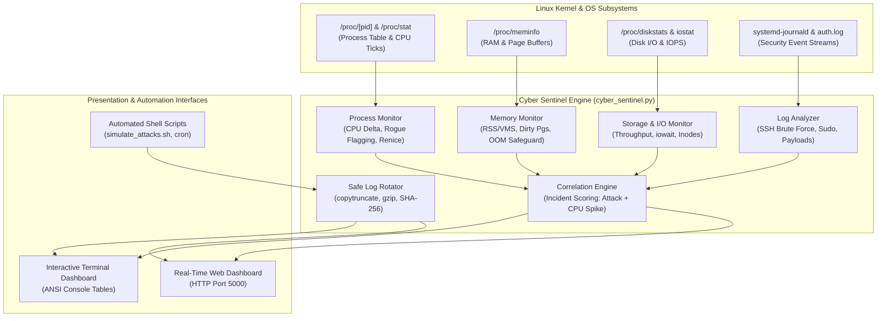

# 🛡️ Cyber Sentinel: Cybersecurity Log Analyzer with Process and I/O Monitoring

**Student Name:** NITHIN N  
**Roll Number:** `25BTRPW066`  
**Course:** Operating Systems Laboratory / Mini Project  
**Course Outcomes Addressed:**  
- **CO2:** Linux Process Management, CPU Scheduling & Priority Remediation (`ps`, `/proc/[pid]/stat`, `renice`, `SIGTERM`)  
- **CO4:** Memory Management, Paging, Page Buffers & OOM Prevention (`/proc/meminfo`, `vm_stat`, RSS/VMS)  
- **CO5:** Storage Hierarchy, Disk I/O & Safe Log Rotation (`iostat`, `/proc/diskstats`, `copytruncate`, `gzip`, SHA-256)  
- **CO6:** Security Telemetry & Shell Script Automation (`journalctl`, `auth.log`, brute force detection, cron)  
**Execution Environment:** Linux (Ubuntu/Debian/CentOS) & macOS (POSIX Darwin), Python 3.10+, Bash  

---

## 📌 1. Project Overview & Problem Statement

Modern enterprise Linux servers face relentless automated cyber attacks—including SSH credential brute forcing, privilege escalation via sudo, and stealthy cryptojacking worms that silently consume CPU cycles and exhaust disk I/O. Traditional system utilities either monitor resource performance (`top`, `iostat`) or analyze static logs in isolation (`fail2ban`, SIEMs), with no cross-subsystem correlation.

**Cyber Sentinel** is a comprehensive Linux system utility that bridges the gap between **OS kernel telemetry** and **cybersecurity threat intelligence**:
1. **Process & CPU Watcher (`/proc`, `ps`):** Samples process states, calculates real-time delta CPU utilization, and detects unlinked/deleted malware binaries or runaway CPU miners. Supports OS priority de-escalation (`renice +19`) or graceful termination (`SIGTERM`).
2. **Memory & Paging Monitor (`/proc/meminfo`, `vm_stat`):** Inspects physical RAM, page caches, dirty writeback buffers, and per-process Resident Set Size (RSS) to avert Linux Out-Of-Memory (OOM) panics.
3. **Storage & I/O Telemetry (`iostat`, `/proc/diskstats`, `statvfs`):** Quantifies disk read/write throughput (MB/s), CPU `iowait` contention, filesystem usage, and available inode health to detect ransomware mass-encryption bursts.
4. **Cybersecurity Log Analyzer (`journalctl`, auth logs):** Analyzes systemd journal streams and auth logs in real-time, detecting SSH brute force intrusions, unauthorized sudo escalations, and reverse shell download scripts (`curl | bash`).
5. **Safe Atomic Log Rotation & Archiving (`copytruncate`, `gzip`, SHA-256):** Solves the classic OS file descriptor concurrency problem using atomic `copytruncate`, compressing rotated logs by **>90%** via `gzip`, and calculating **SHA-256** checksums for forensic audit compliance.
6. **Shell Automation & Web Dashboard:** Features an interactive terminal UI, a dark-mode Flask web dashboard, automated attack simulation scripts, and cron automation.

---

## 🏗️ 2. Subsystem Architecture



---

## 📂 3. Directory Layout

```
cyber_log_analyzer/
├── cyber_sentinel.py           # Master CLI entrypoint (scan, monitor, web, rotate, simulate)
├── config/
│   └── default_config.json     # Configurable thresholds, regex signatures, and retention policies
├── src/
│   ├── process_monitor.py      # [CO2] /proc/[pid] parser, CPU delta metrics, rogue detection, renice
│   ├── memory_monitor.py       # [CO4] /proc/meminfo parser, RAM/swap metrics, dirty page tracker
│   ├── io_monitor.py           # [CO5] /proc/diskstats & iostat parser, throughput & iowait metrics
│   ├── log_analyzer.py         # [CO6] journalctl & auth.log parser, SSH brute force & sudo rules
│   ├── log_rotator.py          # [CO5] Safe atomic copytruncate rotator, gzip, SHA-256 manifest
│   ├── alert_manager.py        # Central multi-vector incident correlation engine
│   └── web_dashboard.py        # Real-time Flask dashboard with live gauges & controls
├── scripts/
│   ├── run_monitor.sh          # Interactive launcher menu (1-6)
│   ├── simulate_attacks.sh     # Automated attack & load demonstration script
│   └── log_rotator_cron.sh     # Scheduled cron script for automated hourly rotation
├── tests/
│   └── test_all.py             # Comprehensive test suite validating CO2, CO4, CO5, CO6
├── logs/                       # Monitored active log directory (auth.log, app.log)
├── archives/                   # Compressed .gz log archives and .meta.json SHA-256 manifests
└── docs/
    └── PROJECT_REPORT.md       # Full Academic Project Report with Viva Voce Defense Sheet
```

---

## 🚀 4. Quick Start & Execution Guide

### Option A: Interactive Launcher Menu (Recommended)
Launch the all-in-one terminal menu:
```bash
bash cyber_log_analyzer/scripts/run_monitor.sh
```

### Option B: Direct CLI Commands

#### 1. Run Complete System Security & OS Telemetry Scan:
```bash
python3 cyber_log_analyzer/cyber_sentinel.py scan
```
*Outputs detailed telemetry tables categorized by CO2, CO4, CO5, and CO6.*

#### 2. Launch Real-Time Live Terminal Monitor:
```bash
python3 cyber_log_analyzer/cyber_sentinel.py monitor
```
*Displays continuous real-time CPU, RAM, I/O wait bars, top processes, and cyber incident alerts.*

#### 3. Launch Interactive Cyber Web Dashboard:
```bash
python3 cyber_log_analyzer/cyber_sentinel.py web --port 5000
```
*Open your browser at **http://localhost:5000** to view live metric gauges, process lists, one-click attack simulator, and archive explorer.*

#### 4. Run Multi-Vector Attack & Load Simulation:
```bash
bash cyber_log_analyzer/scripts/simulate_attacks.sh
```
*Simulates 5 failed SSH brute force logins, unauthorized sudo abuse, reverse shell download, 15,000 log burst lines (>1MB), and triggers automatic copytruncate log rotation with SHA-256 verification.*

#### 5. Trigger Safe Copytruncate Log Rotation:
```bash
python3 cyber_log_analyzer/cyber_sentinel.py rotate --force
```

#### 6. Run Automated Unit & Integration Tests:
```bash
python3 cyber_log_analyzer/tests/test_all.py
```

---

## 🔬 5. Deep-Dive: OS Principles & Course Outcomes (CO)

| Course Outcome | OS Concept | Implementation in Cyber Sentinel |
| :--- | :--- | :--- |
| **CO2: Process & CPU Management** | Process states, Scheduling, PCB (`/proc/[pid]`), Process signals | Direct parsing of `/proc/[pid]/stat`, calculating CPU delta percentages via total system ticks, detecting unlinked binaries, and priority remediation via `os.setpriority` (`renice +19`) or `SIGTERM`. |
| **CO4: Memory Management** | Physical RAM, Virtual Memory (VMS), Resident Set (RSS), Page Caching | Parsing `/proc/meminfo` (`MemTotal`, `MemAvailable`, `Cached`, `Dirty`), tracking process RSS in MB, detecting dirty page accumulation and OOM risk. |
| **CO5: Storage & File Systems** | I/O scheduling, `iostat`, disk wait, atomic file ops, log rotation | Monitoring `/proc/diskstats` for read/write throughput (MB/s) and `iowait` %; implementing atomic `copytruncate` to safely rotate logs without invalidating daemon file descriptors; compressing via `gzip` (>90% savings) and verifying integrity with SHA-256. |
| **CO6: Security & Shell Automation** | Audit logs, pattern detection, shell scripting, cron scheduling | Parsing `journalctl` and `auth.log` with sliding-window brute force detection, detecting reverse shell commands (`curl \| bash`), cron automation, and multi-vector correlation. |

---

## 🛡️ 6. Safe Log Rotation: Why `copytruncate`?

When a daemon (such as `sshd`, `rsyslog`, or `nginx`) runs on Linux, it opens an unbuffered file descriptor pointing to a specific filesystem inode.
- **Problem with naive `rm` / `mv`:** If an admin runs `rm logfile` or `mv logfile logfile.old`, the inode remains open in the kernel's file table. The daemon continues writing to the unlinked inode (consuming disk space without appearing in `ls`), or continues appending to `logfile.old`.
- **The Sentinel Solution (`copytruncate`):**
  1. Opens the source log in read mode and copies all bytes to an intermediate archive.
  2. Opens the original file descriptor in write mode and executes `f.truncate(0)` in-place.
  3. Calls `os.fsync()` to force dirty buffers to physical storage.
  4. The daemon's open file descriptor remains completely valid, and subsequent writes immediately start at byte offset 0.
  5. The intermediate file is compressed into `.gz` format and validated against a SHA-256 hash.
